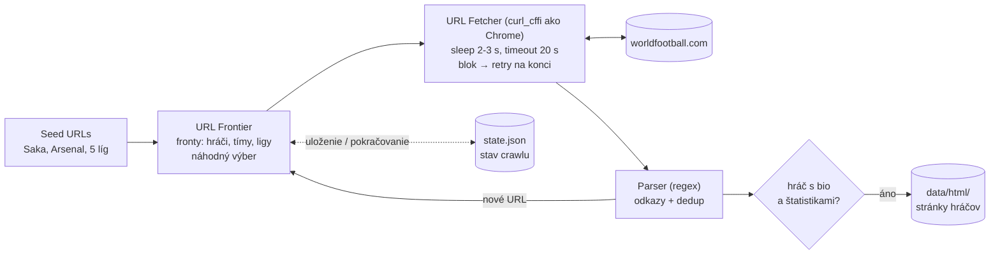
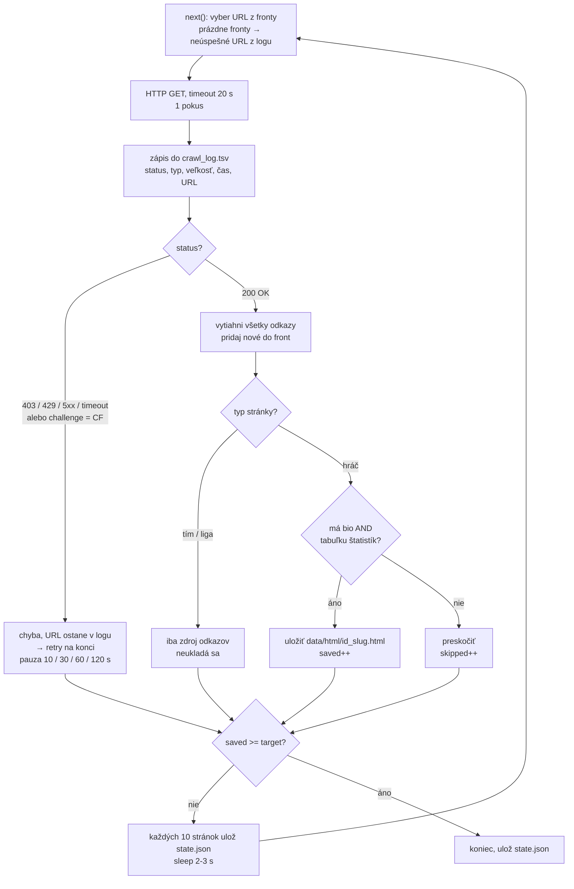

# Diagram architektúry crawlera

Architektúra je inšpirovaná článkom
[HelloInterview - Web Crawler](https://www.hellointerview.com/learn/system-design/problem-breakdowns/web-crawler).
Je zmenšená na jeden proces a jednu doménu (worldfootball.com).

**Rozhranie systému:**
- **Vstup:** seed URL (hráč, tím a 5 líg).
- **Výstup:** HTML stránky hráčov s bio a tabuľkou štatistík v `data/html/`.

## 1. Architektúra

## 2. Spracovanie jednej stránky

