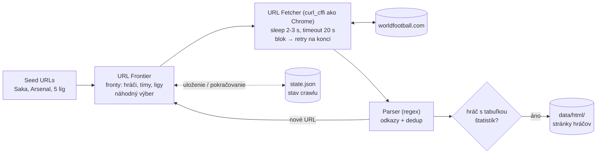
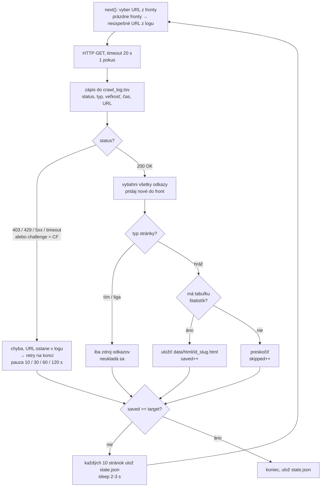
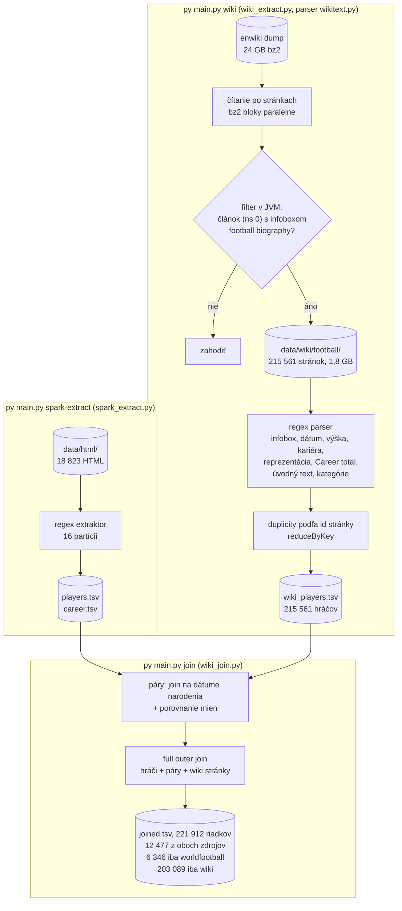
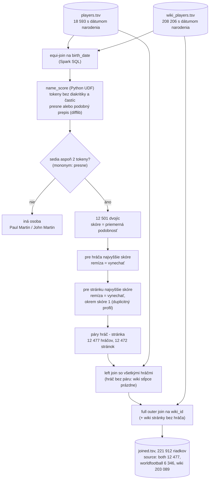

# Diagram architektúry

- **1-2: crawler** (fáza 1)
- **3-4: Spark, wiki dump a join** (fáza 3)

Architektúra crawlera je inšpirovaná článkom
[HelloInterview - Web Crawler](https://www.hellointerview.com/learn/system-design/problem-breakdowns/web-crawler).
Je zmenšená na jeden proces a jednu doménu (worldfootball.com).

**Rozhranie systému:**
- **Vstup:** seed URL (hráč, tím a 5 líg).
- **Výstup:** HTML stránky hráčov s tabuľkou štatistík v `data/html/` (bio nie je podmienka, text doplní wiki).

## 1. Architektúra crawlera

## 2. Spracovanie jednej stránky

## 3. Spark pipeline

Spark beží lokálne (`local[*]`, 8 vlákien). Nadpis bloku je príkaz a súbor s kódom.

## 4. Join hráčov s wiki

worldfootball nemá odkaz na Wikipédiu, samotné meno nestačí (menovci, mononymy, iný prepis).
Kľúčom páru je dátum narodenia a na dvojiciach s rovnakým dátumom sa porovnajú mená.
Nakoniec full outer join, aby sa nestratil žiadny hráč ani wiki stránka.

